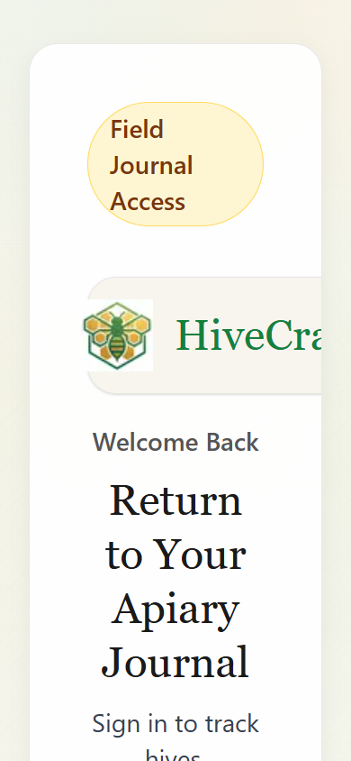
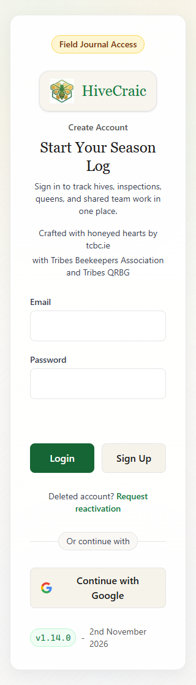

# Rendered-screen review: public access screens

**Date:** 3 November 2026  
**Status:** Public-screen inspection complete; authenticated journeys and field-study findings pending.  
**Dashboard evidence:** The [owner-supplied dashboard screenshots](mobile-first-dashboard-screenshot-review-2026-11-03.md) are reviewed separately; the browser-generated measurements below cover public screens only.

**Related:** [Main review](mobile-first-50-plus-review-2026-11-03.md) � [Field-study pack](mobile-first-field-study-pack-2026-11-03.md)

## What was actually observed

The live public deployment at `https://www.hivecraic.com` was rendered in headless Chrome 156.0.8078.80 on Windows. The page footer displayed v1.14.0, dated 2 November 2026. That visible version matches the source-review version, but the deployment commit was not independently verified.

The Windows Computer Use connection failed with a missing native pipe. A separate headless browser, using the repository's existing Chrome DevTools Protocol helper, successfully captured the public pages. This browser used a fresh temporary profile, desktop Chrome user agent, mobile viewport/touch emulation and device scale factor 1. It did not access an existing signed-in session. A fresh-profile visit to /dashboard settled on /login, confirming that protected screens need authentication. No credentials were entered, account/reset forms submitted or application records changed.

This is real browser rendering, **not a real-phone or field study**. The enlarged-text capture changes the root font size from 16px to 32px. This is a useful layout stress test, not proof of behaviour under iOS Dynamic Type, Android font scaling or browser page zoom. It enlarges rem-based spacing as well as text. No native software keyboard, actual sunlight, screen reader or physical touch accuracy was tested.

## Capture coverage

| Screen/state | Viewport | Theme | Full-page evidence |
| --- | --- | --- | --- |
| Sign in | 320 � 844 CSS px | Light | [Capture](rendered-evidence-2026-11-03/login-320-light.png) |
| Sign in | 390 � 844 CSS px | Light | [Capture](rendered-evidence-2026-11-03/login-390-light.png) |
| Sign in | 390 � 844 CSS px | Dark | [Capture](rendered-evidence-2026-11-03/login-390-dark.png) |
| Sign in, root text 200% | 390 � 844 CSS px | Light | [Capture](rendered-evidence-2026-11-03/login-390-light-root-text-200.png) |
| Password recovery | 320 � 844 CSS px | Light | [Capture](rendered-evidence-2026-11-03/forgot-320-light.png) |
| Registration mode | 320 � 844 CSS px | Light | [Capture](rendered-evidence-2026-11-03/signup-320-light.png) |
| First two keyboard stops | 390 � 844 CSS px | Light | [Email focus](rendered-evidence-2026-11-03/login-focus-1.png) � [Recovery-link focus](rendered-evidence-2026-11-03/login-focus-2.png) |

Viewport-only versions are saved alongside the full-page captures. Full-page images can conceal how much scrolling is required, so use the viewport captures when evaluating what is visible on arrival. [Raw geometry and computed styles](rendered-evidence-2026-11-03/public-screen-measurements.json) and [interaction observations](rendered-evidence-2026-11-03/public-interaction-checks.json) preserve measurement details. The first raw geometry pass enumerates elements with non-zero boxes, including the invisible recovery link in registration mode; it is not a screen-reader accessibility-tree audit.

## Findings from the rendered screens

### R01 � Enlargement exposes clipping despite a passing page-width check

**Priority: P1 validation and bounded layout fix. Evidence: observed under the root-text stress condition.**

At 390px and a 32px root font, the wordmark extends beyond its container and is clipped. The Password label and recovery link become tightly adjacent. The content column becomes very narrow, increasing the document height from 1,026px to 2,984px. Meanwhile the document width still reports 390px. An overflow-width assertion alone would therefore miss the clipped content.

The source is consistent with this observation: the login panel and PageShell hide overflow; the logo uses an unwrapped inline flex layout; the panel has large rem-based padding. This is not yet a blanket WCAG text-resize failure claim, because the stress method is not identical to every supported user text-scaling mechanism.

**Recommendation:** allow the brand block and password-label row to wrap/stack, reduce narrow-screen padding independently of text enlargement and ensure overflow hiding does not mask meaningful content. Preserve generous input and button hit areas. Reproduce at real browser text/zoom settings and on both phone platforms.

**Acceptance:** no clipped labels, brand text or actions under supported 200% text enlargement; the password recovery action remains clearly separated; reflow is checked visually as well as by document width.

### R02 � Registration mode visually prioritises the wrong action

**Priority: P1. Evidence: observed in registration mode and confirmed in the source.**

The heading changes to Create Account / Start Your Season Log, but the supporting copy still says Sign in. Login remains the solid green primary button; Sign Up remains neutral. Both are submit buttons whose click handlers select the mode. The displayed task and strongest visual action disagree.

No registration or authentication request was submitted, so this finding concerns the visible interaction design, not a claim about server behaviour or measured user error rates.

**Recommendation:** use one primary action matching the current task: Sign in or Create account. Make switching modes an explicit secondary action. Change the supporting copy with the mode. Keep Enter submission consistent with the displayed mode.

**Acceptance:** the heading, description, primary button and Enter action all describe the same task; representative users correctly identify the next action without coaching.

### R03 � Introductory content competes with the sign-in task

**Priority: P2. Evidence: measured layout plus visual judgement; participant effect unmeasured.**

At 320px the email field begins 505px down the page and the primary buttons begin at 721px. At 390px they begin at 465px and 681px. The page stacks an access badge, boxed logo, welcome eyebrow, serif heading, description and two attribution lines before the form. At 320px the Google sign-in button starts at 923px, below the initial 844px viewport. Ordinary browser chrome or an open keyboard would further reduce visible space, but those conditions were not emulated here.

The warm palette and serif heading create a coherent field-journal character. The issue is the amount and placement of introductory material, not the existence of branding. A returning beekeeper needs a short, recognisable route into the app.

**Recommendation:** keep the mark/name and a concise heading; move association credits and version detail below the access methods or to About. Reduce redundant framing and make account creation a clearly secondary route when signing in.

**Acceptance:** agree a compact mobile sign-in composition, then compare task-start time and appearance ratings with participants. Do not reduce form text or tap areas to fit more content.

### R04 � Password recovery has a small touch box

**Priority: P2. Evidence: measured.**

The Forgot Password link is about 112 � 20px at 320px width and uses 14px text. This falls below the app's 48px product touch-target goal, even though the primary buttons reach 48px and the fields are 50px high. The recovery route may be especially important to infrequent users.

This is not automatically a WCAG 2.5.8 failure: that criterion has spacing and other exceptions which require a separate assessment. The product goal is deliberately more forgiving.

**Recommendation:** give the recovery link a larger standalone hit area, ideally its own row on narrow screens, while preserving separation from the password field and other actions.

**Acceptance:** a measured, non-overlapping target of at least 48px high for this standalone action; clear focus and text wrapping at enlarged settings.

### R05 � Unfocused fields have faint boundaries

**Priority: P2. Evidence: screenshot and computed colours.**

Light-mode input borders render as `rgb(229,229,229)` against white input surfaces. The fields are distinguishable in a good desktop screenshot but the boundary is subtle; the screenshots also show that the form surface is similarly light. No outdoor visibility conclusion can be drawn from this alone.

**Recommendation:** use a stronger semantic control-border colour, while keeping decorative panel borders quiet. Assess the rendered boundary against applicable non-text contrast requirements and validate recognition outdoors. Focus rings are visible, but they do not help someone locate an unfocused field initially.

**Acceptance:** users can readily identify empty editable fields in light/dark and outdoor conditions; a computed-style contrast check supports the chosen control boundary.

## Observed strengths

- The 320px and 390px normal-size captures have no page-level horizontal overflow. This is a useful result but not sufficient to establish reflow accessibility.
- Email and password values use 16px text; fields are 50px high. Login and Sign Up are 48px high at ordinary text size.
- Email and password have associated labels in the rendered DOM. Password autocomplete is set to current-password in sign-in mode.
- The first two keyboard stops have a visible green outline. The recorded forward sequence includes email, recovery link, password, Login, Sign Up, reactivation and Google sign-in. This sample is not a full keyboard or screen-reader audit.
- Dark mode retains readable light text and a consistent navy/forest identity. There is no evidence here that replacing it with a different dark palette would improve usability.
- Password recovery is visually more focused than sign-in: a clear heading, one field, one primary action and a return route. Its instructions and branding can still be tested for concision.

## How this updates the main review

R01 supplies rendered evidence for the general need to validate enlargement and hidden overflow. It does not establish that the purchase-form layout in F07 fails, because that authenticated form was not rendered. R02 adds a concrete action-hierarchy problem to F10's broader visual consistency theme. R03 supports simplifying access-screen composition while preserving identity. R04 shows why shared button dimensions do not guarantee that all links have adequate touch areas. R05 identifies a control-boundary candidate for the contrast inventory.

The original findings about drafts, outbox, protected navigation, secondary forms and theme policy retain their original confidence levels. Public sign-in screenshots cannot validate those authenticated workflows. No new participant preference, task-completion or outdoor-readability result is claimed.

## Remaining evidence needed

| Area | Status | Next input/action |
| --- | --- | --- |
| Dashboard appearance | Reviewed from six owner-supplied screenshots | Device/zoom metadata and interactive checks remain pending. |
| Hive list and cards appearance | Reviewed from five owner-supplied screenshots | See [hive assessment](mobile-first-hive-screenshot-review-2026-11-03.md); interactions remain pending. |
| Edit Inspection, all five stages | Reviewed from six owner-supplied screenshots | See [inspection assessment](mobile-first-inspection-screenshot-review-2026-11-04.md); save outcomes and interactions remain pending. |
| Hive detail and new-inspection states | Pending | Further screenshots or accessible signed-in test session. |
| Recovery, outbox and storage-failure states | Pending | Disposable study records and controlled failure scenarios; keep real records untouched. |
| Secondary purchase/financial forms | Pending | Signed-in access and representative data. |
| Full 320/360/390/430 matrix, landscape, both themes and reduced motion | Partial | Extend captures after protected access is available. |
| Software keyboard, iPhone/Safari, Android/Chrome and installed PWA | Pending | Real devices; browser emulation does not replace them. |
| Participant task use, appearance preferences and outdoor performance | Not started | Owner/facilitator runs the field-study pack and returns anonymised observations. |

The task remains in progress. The field-study pack is ready for organiser details and participant recruitment; it contains no fabricated results. Application code has not been changed and no build tests have been run.
